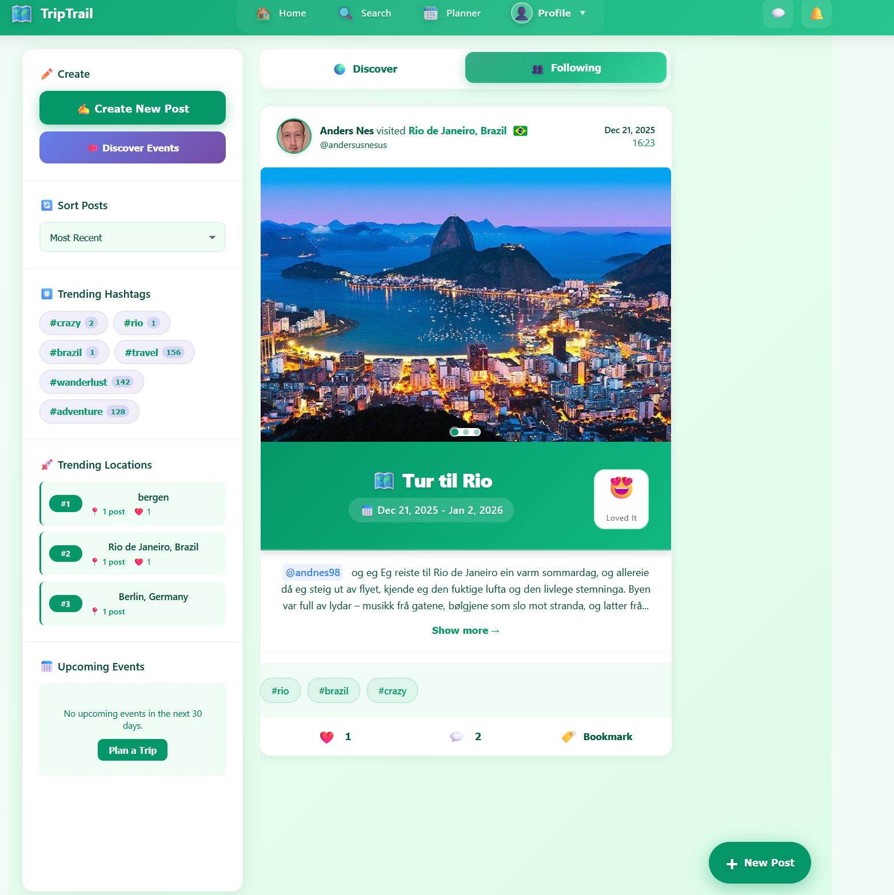

# TripTrail

TripTrail er eit sosialt medium for reiser. Her kan du dele turane dine, planleggje nye reiser saman med andre og sjå kvar i verda du har vore.

Eg har designa og bygd appen sjølv, frå idé til fungerande løysing.

<!-- Legg inn 2–3 skjermbilete her, til dømes feed, profil med verdskart og reiseplanleggar -->
<!--  -->

**Live demo:** _[lenkje kjem]_

## Funksjonar

- **Feed og innlegg.** Del turar med bilete, stad og tekst. Andre kan kommentere og nemne brukarar med @.
- **Utforsk.** Bla i innlegg etter land, stad eller hashtag, og søk etter andre brukarar.
- **Verdskart.** Profilen viser kva land du har besøkt.
- **Reiseplanleggar.** Planlegg ein tur med datoar og attraksjonar, og inviter andre brukarar til å planleggje saman med deg.
- **Stader og arrangement.** Søk opp stader via Google Places og finn arrangement via Ticketmaster.
- **Direktemeldingar og varsel.**
- **Personvern.** Gjer profilen privat, slik at berre godkjende følgjarar ser innlegga dine.
- **Lyst og mørkt tema.**

## Teknologi

| Del | Verktøy |
| --- | --- |
| Frontend | React 19, React Router |
| Backend, innlogging og database | Supabase |
| Kart og stader | Google Maps API, Google Places API, react-simple-maps |
| Arrangement | Ticketmaster API |

## Kom i gang

1. Klon repoet og installer avhengigheiter:

   ```bash
   git clone https://github.com/20AndersDev/Triptrail.git
   cd Triptrail
   npm install
   ```

2. Lag ei `.env`-fil i rotmappa:

   ```
   REACT_APP_SUPABASE_URL=
   REACT_APP_SUPABASE_ANON_KEY=
   REACT_APP_GOOGLE_MAPS_API_KEY=
   REACT_APP_GOOGLE_MAPS_PLACES_API_KEY=
   REACT_APP_TICKETMASTER_API_KEY=
   ```

3. Start appen:

   ```bash
   npm start
   ```

   Appen køyrer då på [http://localhost:3000](http://localhost:3000).

## Om prosjektet

Eit eige prosjekt sidan september 2025. AI-verktøy er brukte som støtte i utviklinga.

Laga av [Anders Nes](https://github.com/20AndersDev).
